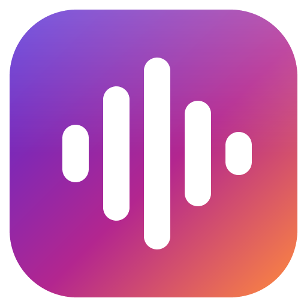
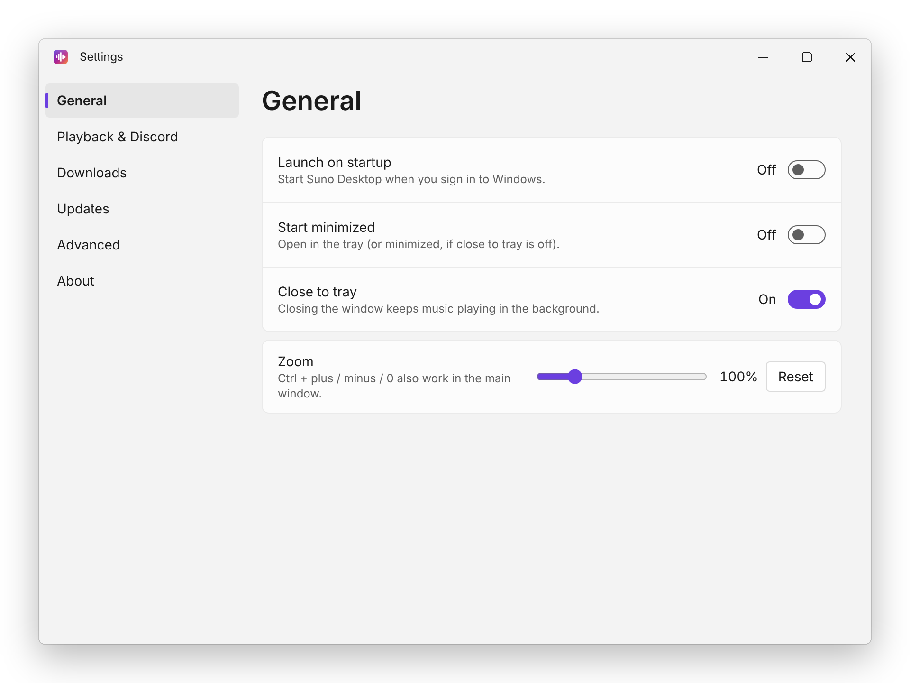
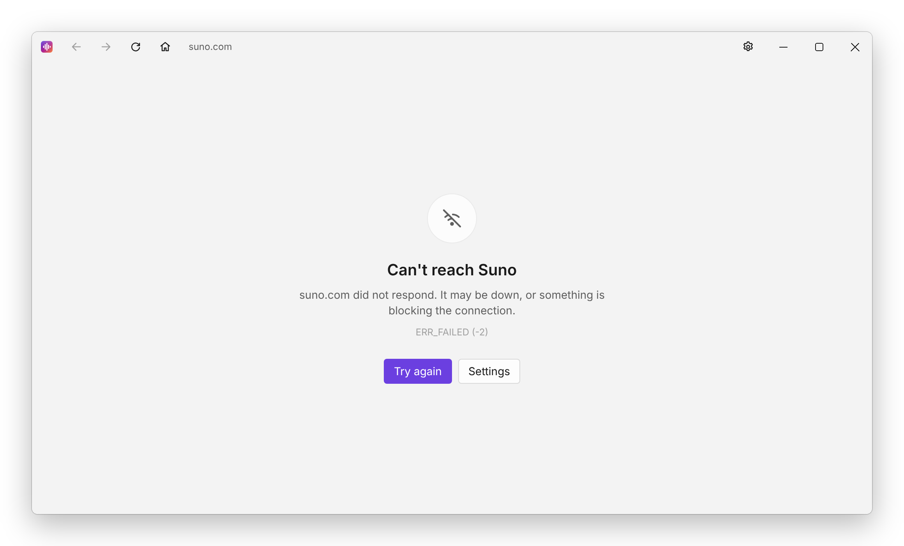
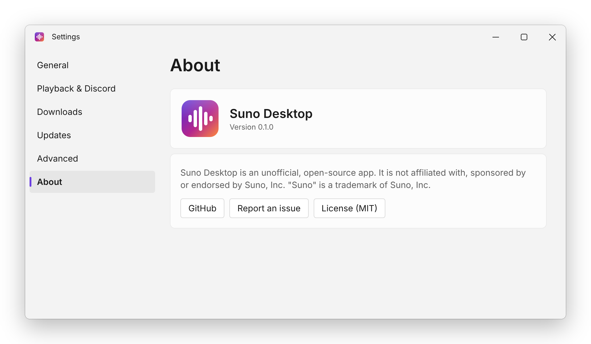
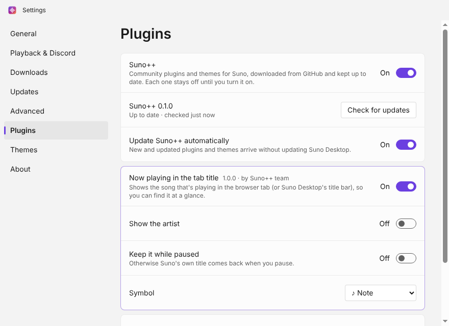
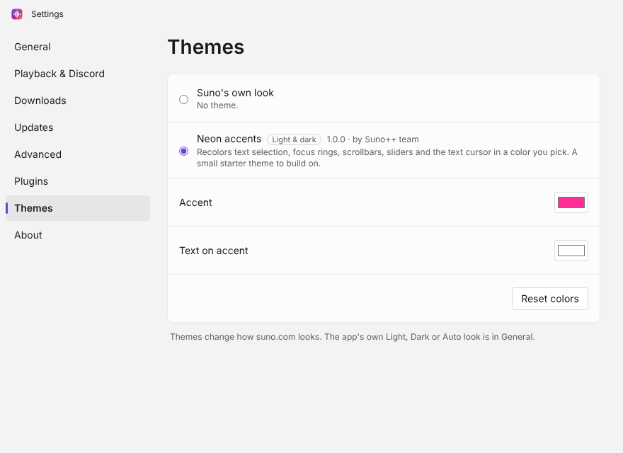

<div align="center">



# Suno Desktop

### Suno, minus the browser tab.

An unofficial Windows app that makes [suno.com](https://suno.com) feel like it was built for Windows 11.<br>
Its own window, real media keys, a tray icon, and music that keeps playing when you close it.

[](https://github.com/Cat-things/suno-desktop/releases/latest)
[](https://github.com/Cat-things/suno-desktop/releases)
[](https://github.com/Cat-things/suno-desktop/actions/workflows/ci.yml)
[](#-install)
[](LICENSE)

<a href="https://github.com/Cat-things/suno-desktop/releases/latest">
  
</a>
<a href="https://www.youtube.com/watch?v=biQnxupaj-w">
  
</a>

<sub>Unofficial and open source · not affiliated with, sponsored by or endorsed by Suno, Inc.</sub>

</div>

<br>

<picture>
  <source media="(prefers-color-scheme: dark)" srcset="docs/images/settings-general-dark.png">
  
</picture>

## 🎬 Watch the trailer

<div align="center">

<a href="https://www.youtube.com/watch?v=biQnxupaj-w">
  
</a>

**[▶️ Watch the Suno Desktop trailer on YouTube](https://www.youtube.com/watch?v=biQnxupaj-w)**

</div>

## ✨ Why?

Suno in a browser tab gets lost between 40 other tabs, stops when you close the wrong window, and your media keys end up pausing a YouTube video instead. Suno Desktop gives Suno its own home on your PC: a real window and taskbar entry, the Windows media controls, a tray icon, and background playback. It's still the regular suno.com, so your account, songs and plan work exactly as they do in your browser.

## 🎛️ Features

<table>
  <tr>
    <td width="50%" valign="top">
      <h3>🪟 Feels native</h3>
      Custom Windows 11 title bar with back, forward, reload and home, snap layouts on the maximize button, Mica on Windows 11 22H2+, and a Light, Dark or Auto theme you pick on first launch.
    </td>
    <td width="50%" valign="top">
      <h3>🎧 Media keys that just work</h3>
      Keyboard media keys and the Windows media overlay control Suno's player. Previous / play-pause / next sit on the taskbar thumbnail too.
    </td>
  </tr>
  <tr>
    <td valign="top">
      <h3>🎶 Keeps the music going</h3>
      Close the window and Suno keeps playing in the tray. Play, pause and skip from the tray menu; quit from there when you're done.
    </td>
    <td valign="top">
      <h3>🎮 Discord Rich Presence</h3>
      Show what you're listening to with cover art, a progress bar and a <b>Listen on Suno</b> button. Off until you turn it on in Settings.
    </td>
  </tr>
  <tr>
    <td valign="top">
      <h3>🔐 Signed in and locked down</h3>
      Your login survives restarts. Suno runs sandboxed, gets only the permissions it needs (it asks before using your mic), and links to other sites open in your normal browser.
    </td>
    <td valign="top">
      <h3>⬇️ Downloads that behave</h3>
      Native save dialog or straight into a folder you pick, progress on the taskbar icon, and a <b>Show in folder</b> notification when it's done.
    </td>
  </tr>
  <tr>
    <td valign="top">
      <h3>🔄 Updates itself</h3>
      New versions download in the background and install when you quit. Stable and beta channels.
    </td>
    <td valign="top">
      <h3>📴 No white screen of nothing</h3>
      Lost your connection? You get a proper offline page that retries on its own when you're back online.
    </td>
  </tr>
  <tr>
    <td valign="top">
      <h3>🔗 Deep links</h3>
      <code>suno-desktop://open?path=/song/…</code> opens a song straight in the app.
    </td>
    <td valign="top">
      <h3>🧩 Plugins & themes, by the community</h3>
      Turn on <b><a href="https://github.com/Cat-things/sunoplusplus">Suno++</a></b> in Settings → Plugins for community-made plugins and themes. They update themselves, and each one stays off until you turn it on.
    </td>
  </tr>
</table>

## 📸 A closer look

<picture>
  <source media="(prefers-color-scheme: dark)" srcset="docs/images/titlebar-strip-dark.png">
  
</picture>
<p align="center"><sub>A title bar that belongs on Windows 11: navigation, settings, and real caption buttons with snap layouts</sub></p>

<table>
  <tr>
    <td width="50%" valign="top">
      <picture>
        <source media="(prefers-color-scheme: dark)" srcset="docs/images/main-offline-dark.png">
        
      </picture>
      <p align="center"><sub>Offline? A real page with retry, not a blank window</sub></p>
    </td>
    <td width="50%" valign="top">
      <picture>
        <source media="(prefers-color-scheme: dark)" srcset="docs/images/settings-about-dark.png">
        
      </picture>
      <p align="center"><sub>Settings → About</sub></p>
    </td>
  </tr>
  <tr>
    <td width="50%" valign="top">
      
      <p align="center"><sub>Suno++ plugins, kept up to date for you</sub></p>
    </td>
    <td width="50%" valign="top">
      
      <p align="center"><sub>Community themes for suno.com, with your own colors</sub></p>
    </td>
  </tr>
</table>

## 🚀 Install

1. Download **`Suno-Desktop-Setup-<version>.exe`** from the [latest release](https://github.com/Cat-things/suno-desktop/releases/latest). One installer covers both x64 and ARM64 PCs.
2. Run it and pick where to install.
3. A quick welcome lets you pick Light, Dark or Auto. Then sign in to Suno like you normally would. That's it: you stay signed in, and the app keeps itself up to date.

> [!WARNING]
> Builds aren't code-signed yet, so Windows SmartScreen will say _"Windows protected your PC"_. Click **More info → Run anyway**. Signing is on the [roadmap](#-roadmap).

> [!TIP]
> Rather not install anything? Grab **`Suno-Desktop-Portable-<version>-x64.exe`** (or **`-arm64.exe`** for ARM PCs) and just run it. Portable builds don't auto-update.

## 🔑 Signing in

Every login option on suno.com opens inside the app, in its own window when the provider wants a popup:

| Provider    | In the app                                                        |
| ----------- | ----------------------------------------------------------------- |
| Google      | ⚠️ Opens, but Google sometimes refuses sign-ins from desktop apps |
| Apple       | ✅                                                                |
| Discord     | ✅                                                                |
| Microsoft   | ✅                                                                |
| Facebook    | ✅                                                                |
| LINE        | ✅                                                                |
| Phone (SMS) | ✅                                                                |

If Google shows _"This browser or app may not be secure"_, use another option. If your Suno account only has Google login, add another sign-in method to it on suno.com in your normal browser first.

## ⌨️ Keyboard shortcuts

| Keys                                                                | Does                                               |
| ------------------------------------------------------------------- | -------------------------------------------------- |
| <kbd>Ctrl</kbd> + <kbd>R</kbd> or <kbd>F5</kbd>                     | Reload                                             |
| <kbd>Ctrl</kbd> + <kbd>Shift</kbd> + <kbd>R</kbd>                   | Reload without cache                               |
| <kbd>Alt</kbd> + <kbd>←</kbd> / <kbd>→</kbd>                        | Back / forward (mouse side buttons work too)       |
| <kbd>Ctrl</kbd> + <kbd>+</kbd> / <kbd>-</kbd> / <kbd>0</kbd>        | Zoom in / out / reset (or <kbd>Ctrl</kbd> + wheel) |
| <kbd>Ctrl</kbd> + <kbd>,</kbd>                                      | Settings                                           |
| <kbd>F11</kbd>                                                      | Full screen                                        |
| <kbd>F12</kbd> or <kbd>Ctrl</kbd> + <kbd>Shift</kbd> + <kbd>I</kbd> | Developer tools (turn on in Settings → Advanced)   |

## ❓ FAQ

<details>
<summary><b>Is this made by Suno?</b></summary>
<br>
No. Suno Desktop is an independent, open-source project. It isn't affiliated with, sponsored by or endorsed by Suno, Inc. It shows the regular suno.com website in a desktop window.
</details>

<details>
<summary><b>Can the app see my password?</b></summary>
<br>
Signing in happens on Suno's and your provider's own pages, loaded as they are. The app injects nothing into those pages and never reads or stores passwords. Your session cookies stay on your PC in <code>%APPDATA%\Suno Desktop</code>.
</details>

<details>
<summary><b>Does it unlock free credits or skip limits?</b></summary>
<br>
Nope. It's the same website, so plans, credits and limits work exactly like in your browser.
</details>

<details>
<summary><b>Why is the installer around 200 MB?</b></summary>
<br>
It carries complete x64 and ARM64 builds (each with its own Chromium) so that one installer and one update feed work on every PC. Only the build your PC needs gets installed. The portable exes are per-architecture and about half the size.
</details>

<details>
<summary><b>How do I sign out or start fresh?</b></summary>
<br>
Settings → Advanced has two buttons. <b>Reset app settings</b> puts every app setting back to default and shows the welcome screen again, but keeps you signed in to Suno. <b>Clear session and log out</b> signs you out and deletes Suno's cookies and cache. To wipe everything, uninstall the app and delete <code>%APPDATA%\Suno Desktop</code>.
</details>

<details>
<summary><b>Something's broken. Where are the logs?</b></summary>
<br>
<code>%APPDATA%\Suno Desktop\logs\main.log</code>. Attach it to an <a href="https://github.com/Cat-things/suno-desktop/issues">issue</a> along with your Windows version.
</details>

<details>
<summary><b>Can I make my own plugins or themes?</b></summary>
<br>
Yes! Plugins and themes live in <b><a href="https://github.com/Cat-things/sunoplusplus">Suno++</a></b>, which anyone can contribute to (<a href="https://github.com/Cat-things/sunoplusplus/blob/main/CONTRIBUTING.md">how</a>). Once yours is merged, it reaches Suno Desktop by itself in the next Suno++ release, no app update needed, and it works in the Suno++ browser extension too. Not a coder? Share ideas in <a href="https://github.com/Cat-things/suno-desktop/discussions">Discussions</a>. How the app loads Suno++: <a href="docs/PLUGIN_HOOKS.md">docs/PLUGIN_HOOKS.md</a>.
</details>

<details>
<summary><b>Mac or Linux?</b></summary>
<br>
Windows only for now. It may run from source elsewhere, but it isn't built or tested for other platforms.
</details>

## 🐛 Known issues

- **Google sign-in can be blocked** by Google (see [Signing in](#-signing-in)).
- **SmartScreen warns** on first launch until releases are signed.
- **Next / previous** buttons light up only when suno.com offers next and previous track controls to the browser.
- **The "Listen on Suno" button** in Discord shows for your friends, not for you. That's how Discord displays buttons.
- **Mica** needs Windows 11 22H2 or newer. Older versions get a solid title bar.

## 🧭 Roadmap

- [x] Native window, media keys, tray, downloads, offline page
- [x] Auto-updates with stable and beta channels
- [x] Automatic releases
- [x] Discord Rich Presence (opt-in)
- [x] First-launch welcome with Light, Dark and Auto themes
- [ ] Code signing (no more SmartScreen warning)
- [ ] A proper app icon
- [x] **Suno++**: community-made **plugins and themes**, built in and updating themselves
- [ ] A Suno++ marketplace page and smarter style recommendations for the Create page

## 🛠️ Build it yourself

<details>
<summary><b>Run from source</b></summary>
<br>

You need Node.js 22.12+ and pnpm 10 (`corepack enable` picks up the pinned version).

```sh
pnpm install
pnpm dev              # run with hot reload
pnpm test             # unit tests
pnpm build            # bundle main, preloads and UI into out/
pnpm test:e2e         # end-to-end tests against the built app (Linux: xvfb-run -a pnpm test:e2e)
pnpm lint && pnpm typecheck
```

Package for Windows (run on Windows):

```sh
pnpm dist:win         # NSIS installer (x64 + arm64) and portable exes in dist/
pnpm dist:dir         # unpacked app only, the quickest way to try a packaged build
```

</details>

<details>
<summary><b>How builds and releases work</b></summary>
<br>

- **Test builds**: every push to any branch runs [Build Windows](.github/workflows/build-windows.yml), which builds the unsigned installer and both portable exes and attaches them to the run as artifacts for 14 days. You can also start it by hand from the Actions tab.
- **Releases**: [Release](.github/workflows/release.yml) publishes a GitHub release automatically after every **3 commits on `main`**. It bumps the patch version (0.1.0 → 0.1.1 → …), tags the commit it built, uploads the installer, portable exes and `latest.yml` (for auto-update), and writes release notes from the commit list.
- **Release now**: Actions → Release → **Run workflow**, or push a `vX.Y.Z` tag. Prereleases like `v0.2.0-beta.1` go to the beta channel.
- **New minor or major version**: set it in `package.json`; the next release uses it.

</details>

<details>
<summary><b>Configuration</b></summary>
<br>

- **Discord Rich Presence** uses the Discord application ID in [`config/app.config.json`](config/app.config.json). Forks can point it at their own application from the [Discord Developer Portal](https://discord.com/developers/applications) (its name is what shows after "Listening to"); upload an art asset named `logo` there for songs without a cover. For local testing you can set `SUNO_DESKTOP_DISCORD_CLIENT_ID` instead. It stays off until the user turns it on.
- **Icons** are placeholders. Replace `build/icon.svg` and `resources/tray.svg`, then run `pnpm icons`.

</details>

## 📚 Docs

- [Architecture](docs/ARCHITECTURE.md): windows, the security model, IPC and how media controls flow
- [Suno++ and the plugin hooks](docs/PLUGIN_HOOKS.md): how the app downloads, updates and runs Suno++
- [Testing](docs/TESTING.md): what CI checks and the manual Windows checklist

## 🤝 Community

- 💬 **Questions, ideas, plugin or theme wishes?** Head to [Discussions](https://github.com/Cat-things/suno-desktop/discussions).
- 🐛 **Found a bug?** [Open an issue](https://github.com/Cat-things/suno-desktop/issues/new/choose); the form asks for what we need.
- 🔒 **Security problem?** Report it privately, see [SECURITY.md](SECURITY.md). Please don't open a public issue.
- 🛠️ **Want to contribute?** Pull requests are welcome. Before you push, run `pnpm lint && pnpm typecheck && pnpm test`; CI runs those plus end-to-end tests on Linux and Windows.

More on where to go in [SUPPORT.md](SUPPORT.md).

## ⚖️ License

[MIT](LICENSE). "Suno" is a trademark of Suno, Inc. This project ships none of Suno's logos or assets.
